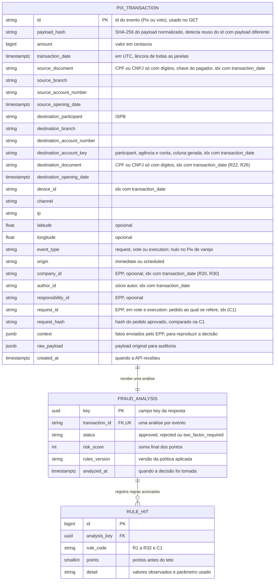

# RFC — Motor antifraude Pix com regras pontuadas, histórico local e decisão idempotente

| | |
|---|---|
| **Time** | Hugo Gomes · Leandro Apolinário Leite · Mateus Carósio |
| **Data** | 17/10/2026 |
| **Versão** | 5 |

## Contextualização

### Entendendo o problema

O sistema chamador envia cada pedido de Pix e o motor responde, antes do dinheiro sair e em poucos
segundos, `approved`, `two_factor_required` ou `rejected`, sem analista, sem consulta externa pesada
e sempre com um motivo explicável. Uma transação isolada diz pouco, então cada Pix é comparado com o
que o pagador, o destinatário e o dispositivo já fizeram. O chamador principal é a conta compartilhada
de EPP (empresa de pequeno porte com vários sócios): o dinheiro é da empresa, cada operação tem um sócio autor, e o risco inclui o golpe externo,
o sócio malicioso, os sócios coniventes, a sessão sequestrada e o contorno dos controles internos; por
isso o motor também avalia votos de aprovação e pagamentos programados. Três erros custam caro: aprovar uma fraude libera
um dinheiro difícil de recuperar; barrar um cliente bom (o aluguel pago pela primeira vez a um novo
locador, a folha do mês) gera fricção e prejuízo; e o mesmo evento receber duas decisões, ou uma
rajada paralela passar sem ser vista porque cada requisição leu um histórico incompleto. Todo evento
válido e toda análise ficam gravados e consultáveis (a requisição recusada na validação, `400` ou
`422`, não vira evento). **Fora do escopo:** onboarding e cadastro de contas,
front-end, outras APIs, movimentar dinheiro, aplicar a decisão (quem exige o segundo fator ou a
aprovação adicional é o chamador), regra de saldo no Pix de varejo (o payload dele não traz saldo),
machine learning, a governança do quórum (notificação e contestação dos sócios, decisão de produto) e a
comunicação de operações suspeitas, que é do compliance.

### Explicando a solução de forma macro

A API valida e normaliza o evento, trava as chaves envolvidas (o próprio `id`, o pagador e a conta
destino) dentro de uma transação PostgreSQL, lê o histórico local já gravado, junta os fatos que só o
EPP conhece (saldo livre, limites, ativação da conta, mudanças de controle), confere a integridade
entre pedido, voto e execução (C1), avalia 32 regras determinísticas (R1 a R12, R28 e R29 de Pix; R13 a
R27 e R30 a R32 do contexto EPP) e soma pontos. Cada regra é uma função
pura (evento + contexto de histórico → pontos e detalhe), o que permite testá-la sem banco; as
camadas seguem o Base Service (rota, serviço, repositório). A soma vira o status por faixas, com tetos
para famílias de sinais correlacionados, de modo que valor alto, ou sinais de sessão, sozinhos nunca
reprovam. Evento, análise e regras acionadas são gravados na mesma transação de banco. O `id` do
evento (o Pix ou o voto) é a chave de idempotência, e o `payload_hash` distingue reenvio legítimo de
reuso indevido do `id`. O contrato do desafio não muda: o payload de exemplo, sem `context`, é aceito e
analisado só pelo núcleo; o `context` é uma extensão opcional da entrada.

- **Decidir por regra isolada (a primeira que casa decide, ou qualquer alerta reprova)** —
  descartada porque perde contexto (três sinais moderados juntos valem mais que cada um sozinho) e
  dispara falsos positivos, travando quem só quer pagar. Ganharia se o cliente exigisse bloqueios
  categóricos, como lista de contas proibidas, ou se a perda média por fraude fosse muito maior que o
  custo de fricção, como em contas já marcadas como de alto risco.
- **Consultar bases externas a cada Pix** — descartada porque a latência e a dependência externa
  quebram o "poucos segundos". Ganharia se houvesse uma base de reputação com SLA em milissegundos ou
  cache local confiável.
- **Modelo de machine learning** — descartado porque exige dados rotulados de fraude confirmada,
  avaliação e monitoramento que não existem aqui. Ganharia com esse histórico rotulado; as regras
  gravadas por evento servem de base auditável para isso.
- **Contadores em memória (Redis) ou isolamento `SERIALIZABLE` em vez de lock consultivo** —
  descartados porque o primeiro cria uma segunda fonte de verdade fora do banco, que pode divergir
  do histórico gravado, e o segundo faz requisições concorrentes falharem e exigirem retentativa.
  Ganhariam se o volume exigisse latência abaixo do que o PostgreSQL entrega ou se as regras só
  precisassem de contadores aproximados.
- **Bloquear em tempo real os padrões de lavagem de dinheiro (giro de dias, ciclos entre contas)** —
  descartado na v5 porque esses padrões são lentos e têm alto risco de falso positivo, e a decisão de
  comunicar uma operação suspeita é do compliance, não do motor. Viram alertas de 0 ponto para o
  back-office (roadmap). Ganhariam com uma base de casos confirmados para calibrar o corte entre alerta
  e bloqueio.

## Implementação

### Rotas

| Método | Caminho | O que faz | Entrada (campos que importam) | Saídas (status e quando) |
|---|---|---|---|---|
| `POST` | `/pix/transaction` | Valida, analisa, grava e devolve a decisão. **Idempotente:** `id` do evento (Pix ou voto) com `UNIQUE` no banco + `payload_hash` do payload normalizado. | `id`; `amount` (centavos); `transaction_date` (com fuso); `source_account.owner.document_number` e `opening_date`; `destination_account` (`participant`, `branch`, `account_number`, `owner.document_number`, `opening_date`, opcional no EPP); `source.device_id`, `channel`, `ip`, `geolocation` (opcional). **`context` (opcional, enviado pelo EPP):** `event` (`request`, `vote`, `execution`), `origin` (`immediate`, `scheduled`), `company_id`, `author_id`, `responsibility_id`, e os fatos que só o EPP conhece (saldo livre, limites aplicáveis, ativação da conta, mudanças de controle e entradas das últimas 24 h, liberação de reserva, documentos dos sócios; novos na v5: `request_id` e `request_hash`, obrigatórios em `vote` e `execution`, `credential_changed_at` e `destination_partner_documents`, opcionais) | `201` análise criada, com `key`, `status` e `metadata` (`risk_score`, `reasons`, `rules_version`, `recommended_actions`); `200` mesmo `id` e mesmo payload: devolve a análise já gravada, sem reprocessar; `400` corpo ilegível ou JSON malformado; `409` mesmo `id` com payload diferente; `422` campo ausente ou de tipo errado, `amount` não inteiro ou ≤ 0, data sem fuso, documento sem 11 ou 14 dígitos, latitude ou longitude fora da faixa, `context` com `event` inválido ou sem `author_id`, ou `vote`/`execution` sem `request_id` e `request_hash`; `500` falha interna: tudo é revertido e o reenvio é seguro |
| `GET` | `/pix/transaction/{id}` | Devolve a análise gravada (somente leitura). `{id}` é o `id` do evento, não o `key`. | `id` na URL | `200` `key`, `status` e `metadata`; `404` nenhuma análise para esse `id` |

### Banco de Dados (Somente diagrama)

### Fluxos

**POST `/pix/transaction` — caminho feliz**

1. Validar a requisição (`400`/`422`) e normalizar: documentos só com dígitos, datas em UTC,
   geolocalização opcional, bloco `context` quando existir. Calcular o `payload_hash` sobre o payload
   normalizado.
2. Abrir a transação PostgreSQL e obter `pg_advisory_xact_lock` sobre três chaves, sempre na mesma
   ordem (`id`, pagador, conta destino) para evitar deadlock. Os locks caem no commit.
3. Buscar o `id`. Se existir com o mesmo hash, devolver `200` com a análise existente. Se o hash for
   diferente, devolver `409`. Nos dois casos, nada é reprocessado.
4. Carregar o contexto de histórico com consultas agregadas e indexadas e juntá-lo ao `context` do EPP.
   As janelas são relativas à `transaction_date` do próprio evento, usam só registros com data menor ou
   igual a ela e excluem o próprio `id`.
5. Rodar a checagem C1 (só em `vote` e `execution`), executar as regras aplicáveis de R1 a R32 em ordem
   fixa, aplicar modificadores e tetos, somar e mapear a faixa em `status`; se a C1 for acionada, o
   `status` é `rejected`.
6. Gravar `PIX_TRANSACTION`, `FRAUD_ANALYSIS` e `RULE_HIT` na mesma transação, fazer commit e devolver
   `201` com `key`, `status` e `metadata`.

**Regras de Pix avaliadas no passo 5** (parâmetros iniciais, calibrados com os cenários de teste e
repetidos no README)

| Regra | Lógica e parâmetros | Pts | Por quê |
|---|---|---|---|
| **R1 Limite** | `amount` ≥ R$ 5.000 | 2 | Valor alto aumenta a exposição, mas não prova fraude: sozinho leva só a 2FA. O piso é um ponto de partida para Pix de uso comum alto (aluguel, parcela). |
| **R2 Velocity** | ≥ 5 Pix do pagador em 60 s, contando o atual, qualquer status | 2 | Pessoa raramente faz 5 Pix por minuto; script faz. Conta tentativas rejeitadas, porque a rajada é o sinal. |
| **R3 Montante acumulado** | Soma do pagador em 10 min ≥ R$ 10.000, com pelo menos 2 Pix na janela | 2 | Pega valor fatiado que escapa do R1. R$ 10.000 é o dobro do piso do R1, então quem fatia precisa ultrapassar bastante o limite individual. Exigir 2 Pix evita contar duas vezes um único Pix grande. |
| **R4 Desvio de perfil** | `amount` ≥ 5× a mediana dos últimos 20 Pix não rejeitados do pagador, com histórico ≥ 5 e `amount` ≥ R$ 500 | 2 | A mediana resiste a valores atípicos; 5× evita oscilação normal; o piso evita disparar em valores pequenos; o histórico mínimo evita inventar perfil de cliente novo. |
| **R5 Contraparte nova** | Pagador sem Pix anterior para essa conta destino, com histórico ≥ 3 e `amount` ≥ R$ 1.000 | 1 | Destinatário novo é contexto, não motivo isolado. O histórico mínimo impede que o primeiro Pix de todo cliente pontue. |
| **R6 Destino recém-aberto** | Conta destino com ≤ 30 dias na `transaction_date`, medidos em tempo decorrido, e `amount` ≥ R$ 1.000 (se o R8 dispara, vale a soma da janela dele); sem `opening_date` do destino, não pontua | 2 | Contas recentes concentram risco de conta de passagem. 30 dias evita a fronteira apertada de 7 dias. |
| **R7 Dispositivo novo** | `device_id` fora dos dispositivos dos últimos 20 Pix não rejeitados do pagador, com histórico ≥ 3 e `amount` ≥ R$ 500 | 2 | Troca de aparelho é legítima, por isso só pontua com valor relevante e perfil existente. |
| **R8 Fracionamento** | ≥ 3 Pix do pagador para a mesma conta destino em 5 min, cada um < R$ 1.000, com soma ≥ R$ 2.000 | 2 | Detecta quem fica abaixo do piso do R6 dividindo o valor; por isso, quando dispara, o R6 olha a soma da janela e não cada Pix. |
| **R9 Destino concentrador** | Conta destino recebeu de ≥ 5 pagadores distintos em 60 min, com soma ≥ R$ 10.000, contando o atual; não vale para destinatário CNPJ com conta > 30 dias | 3 | Padrão de conta de passagem. 5 pagadores distintos em uma hora é incomum fora do comércio, e o piso de R$ 10.000 evita pontuar vaquinhas pequenas. A exceção protege comerciantes legítimos. |
| **R10 Pagador recente** | Conta pagadora com ≤ 30 dias e `amount` ≥ R$ 2.000; vale 2 se o pagador tem < 3 Pix no histórico | 1 (2 sem perfil) | Sinal complementar de idade da conta. 30 dias acompanha o R6; o piso é maior (R$ 2.000) porque conta nova, sozinha, não é suspeita. Sem 3 Pix de histórico, R4, R5 e R7 não avaliam e o R10 é a única proteção: por isso vale 2 e leva a 2FA (na v4, o primeiro Pix de R$ 4.900 de uma conta de 10 dias saía `approved`). |
| **R11 Deslocamento impossível** | Com geolocalização nos dois Pix, o Pix anterior do pagador foi há ≤ 60 min, a distância é ≥ 50 km e a velocidade implícita é > 900 km/h | 3 | Sugere sessão usada de outro lugar. 900 km/h é a ordem de um voo comercial; 50 km filtra ruído de GPS. Sem geolocalização, não pontua. |
| **R12 Dispositivo compartilhado** | Mesmo `device_id` usado por ≥ 3 documentos pagadores distintos em 24 h | 2 | Um aparelho servindo várias titularidades sugere fazenda de contas. 3 documentos deixa de fora o aparelho dividido por duas pessoas (casal, família). |
| **R28 Valor colado no piso** | ≥ 3 Pix do pagador em 24 h, contando o atual e qualquer status, cada um entre R$ 4.500 e R$ 4.999,99 (90% a 99,99% do piso do R1) | 2 | O R1 é um degrau: R$ 4.999 vale 0 e R$ 5.000 vale 2, e quem conhece o piso fica logo abaixo. Um Pix assim é normal; três no mesmo dia são teste. Entra na família de valor. |
| **R29 Fracionamento por documento** | ≥ 4 Pix do pagador para o mesmo documento destino (qualquer conta) em 60 min, contando o atual, soma ≥ R$ 5.000, sem teto por Pix; não vale para destinatário recorrente (≥ 3 Pix anteriores ao início da janela) | 2 | O R8 só vê a mesma conta, 5 min e Pix < R$ 1.000: seis Pix de R$ 1.499 passavam por R2, R3 e R8. 4 Pix em 1 h separam fracionamento de duas ou três compras seguidas; R$ 5.000 é o piso do R1, então dividir para fugir dele é o caso. Compartilha teto com o R8. |

**Ajustes de R1 a R12, R28 e R29 quando há `context`** (sem `context`, as regras valem como estão)

| Regra | No EPP | Por quê |
|---|---|---|
| **R1 Limite** | **Não avalia** | O limite do sócio e a regra de aprovação já controlam o valor, e pagar fornecedor acima de R$ 5.000 é rotina de empresa. R4, R13 e R20 cobrem o desvio. |
| **R2 Velocity** | Igual; execução `scheduled` não pontua | A folha em lote é uma rajada legítima, já aprovada. |
| **R3 Montante acumulado** | Igual; execução `scheduled` não pontua | Mesmo motivo do R2. |
| **R4 Desvio de perfil** | **Adaptada:** mediana e histórico mínimo por `responsibility_id` do pedido, quando houver | Folha e despesa pequena não dividem a mesma mediana; o perfil de uma empresa só faz sentido por responsabilidade. |
| **R5 Contraparte nova** | Igual; execução `scheduled` não pontua | Fornecedor novo é rotina; o R23 trata o caso específico da responsabilidade. |
| **R6 Destino recém-aberto** | Igual | Conta de passagem é risco para qualquer pagador. |
| **R7 Dispositivo novo** | **Não avalia** (vale o R17) | Conta compartilhada tem vários sócios, cada um com seus aparelhos; o histórico por conta geraria falso positivo. |
| **R8 Fracionamento** | Igual | Fugir do limite do sócio também é fracionar; o R13 pega o valor colado ao limite. |
| **R9 Destino concentrador** | **Não avalia** (vale o R26) | Os "pagadores distintos" do EPP são empresas, e o R26 é a mesma regra com janela de 24 h. |
| **R10 Pagador recente** | **Não avalia** (vale o R24) | A idade da conta pagadora é a ativação, e o R24 já a mede. |
| **R11 Deslocamento impossível** | **Não avalia** (vale o R18) | Dois sócios em cidades diferentes são normais; só faz sentido por autor. |
| **R12 Dispositivo compartilhado** | **Adaptada:** ≥ 3 `author_id` distintos, de empresas diferentes, em 24 h | Sócios da mesma empresa no computador do escritório, ou um sócio com várias empresas, não são fazenda de aparelhos. |
| **R28 Valor colado no piso** | **Não avalia** (vale o R13) | O R1 não existe no EPP, então não há piso para colar; o teto que importa é o do sócio, que o R13 mede. |
| **R29 Fracionamento por documento** | Igual | Fracionar entre contas do mesmo titular é risco para qualquer pagador. |

**Regras do contexto EPP avaliadas no passo 5** (R13 a R27 e R30 a R32; só quando há `context`; o "autor" é o sócio que
criou o pedido; "recorrente" é a contraparte já paga ≥ 3 vezes pela empresa)

| Regra | Lógica e parâmetros | Pts | Por quê |
|---|---|---|---|
| **R13 Valor colado no limite** | ≥ 3 pedidos do autor em 24 h, cada um entre 90% e 99,9% do menor valor entre o limite do autor e o gatilho de aprovação; não conta recorrente | 2 | Quem testa o controle repete valores logo abaixo dele; mensalidade fixa não é teste. |
| **R14 Recriação após recusa** | Pedido do autor para a mesma contraparte com valor de 80% a 120% de um pedido dele recusado por outro sócio em ≤ 24 h; cancelamento pelo autor não conta | 2 | A recusa é sinal de controle interno que o Pix de varejo não tem. |
| **R15 Aprovação disfarçada** | No evento `vote`: mesmo `device_id` do autor do pedido, ou mesmo IP e voto em < 10 s da criação | 3 | Quórum exige pessoas distintas; o EPP só barra o autor votando em si. IP sozinho é fraco (mesmo escritório). |
| **R16 Afrouxamento de controle seguido de uso** | Em ≤ 24 h depois de elevar limite, criar permissão, afrouxar regra de aprovação, definir substituto, remover ou incluir sócio ou reduzir o quórum, o pedido só passa por causa disso; ignora empresa com < 7 dias de conta | 3 | Mexer nos controles pouco antes de usar é o padrão de abuso de um sistema de controles configuráveis. Tirar um sócio ou baixar o quórum antecede o desvio entre sócios coniventes. |
| **R17 Dispositivo novo do sócio** | R7 pelo histórico do autor (não da conta): `device_id` fora dos últimos 20 pedidos não rejeitados dele, histórico ≥ 3, valor ≥ R$ 500 | 2 | Numa conta compartilhada, cada sócio tem seus aparelhos. |
| **R18 Deslocamento e IP do sócio** | R11 por autor, janela ≤ 12 h; sem geolocalização, país do IP (base local) diferente do último IP do autor | 3 | Sessão usada de outro lugar; a janela maior cobre voos longos. |
| **R19 Horário atípico** | Pedido imediato criado entre 0h e 5h (fuso do Brasil), valor ≥ R$ 1.000, autor com ≥ 10 operações e nenhuma nesse horário | 1 | Usa a hora de criação, nunca a da execução, para não punir pagamento agendado. |
| **R20 Esvaziamento** | Saídas pagas com saldo livre nas últimas 24 h, contando a atual, somam ≥ 70% do saldo livre anterior à primeira delas (saldo livre antes do pedido + saídas livres anteriores da janela) e ≥ R$ 5.000; pagamento coberto por reserva de responsabilidade não conta | 2 | Folha e imposto saem de reserva por desenho; saldo livre drenado é o sinal. Medir só por evento deixava passar três saídas de 60% do saldo restante (cerca de 94% drenado sem acionar nada); acumulado em 24 h, a segunda (84%) já dispara. |
| **R21 Liberação de reserva seguida de saída** | Liberação ou transferência entre reservas e, em ≤ 30 min, saída do autor ≥ 80% do liberado para contraparte nova | 3 | Tira da empresa o dinheiro de impostos ou folha. |
| **R22 Destino é sócio** | Contraparte com o CPF de um sócio, valor ≥ R$ 2.000; não vale para recorrente com valor ±20% (pró-labore) | 1 | O dinheiro é da empresa, não dos sócios; isolada pesa pouco, soma com R13, R15 ou R20. |
| **R23 Contraparte nova para a responsabilidade** | Responsabilidade com ≥ 5 pagamentos e ≤ 3 contrapartes em 90 dias recebe pedido de contraparte nunca paga por ela, valor ≥ R$ 1.000 | 1 | Responsabilidade previsível (impostos) pagando destino fora do padrão. Não soma com o R5: o mesmo fato não conta duas vezes. |
| **R24 Conta recém-ativada com saída grande** | Ativada há ≤ 30 dias: saída externa ≥ R$ 5.000 vale 1; ≥ R$ 20.000 vale 2 | 1–2 | Usa a ativação, não o cadastro, pois a conta só movimenta depois da aprovação do back-office. |
| **R25 Passagem entrada → saída** | Entradas externas ≥ R$ 10.000 em 24 h e saída ≥ 80% delas em ≤ 2 h para contraparte nova, em empresa ativa há ≤ 90 dias ou só com pagadores novos | 3 | Conta de passagem. É a de maior risco de falso positivo: calibrar primeiro. |
| **R26 Destinatário em rede** | Mesmo documento de contraparte recebendo pedidos de ≥ 4 empresas em 24 h, soma ≥ R$ 10.000, contando o atual; não vale se for recorrente para a empresa atual | 3 | Só a plataforma enxerga várias empresas. Revisar a base legal (LGPD) e consultar por hash do documento. |
| **R27 Sócio de muitas empresas (alerta)** | Mesmo CPF de sócio (`partner_documents`) em ≥ 3 `company_id` distintos com eventos nos últimos 30 dias, contando o atual | 0 | Só alerta, em `reasons`, para o back-office; não altera o status. Usa a atividade que o motor viu, não o cadastro, que está fora do escopo. |
| **R30 Saída da empresa fora do padrão** | Saídas livres da empresa em 24 h (contando a atual; exclui pagamento coberto por reserva e execução `scheduled`) ≥ 3× a média diária dos 30 dias anteriores à janela e ≥ R$ 10.000; empresa ativada há ≥ 30 dias e com ≥ 10 saídas no período | 2 | R13, R14 e R17–R19 olham um autor por vez e o R3 só olha 10 min: quatro sócios abaixo do próprio limite passavam. É o único sinal que não depende de quem pede. 3× filtra a oscilação de fim de mês; o piso evita empresa pequena; sem 30 dias não há média confiável. |
| **R31 Destino ligado a sócio** | Contraparte é CNPJ do qual um sócio da empresa também é sócio, ou CPF de sócio de outra empresa da plataforma (`destination_partner_documents`, quando a plataforma conhece a contraparte); valor ≥ R$ 2.000; não vale para recorrente com valor ±20% | 2 | Desviar para a segunda empresa do mesmo sócio contorna o R22, que só compara CPF. Pesa mais que o R22 porque exige vínculo comprovado. R22 e R31 são o mesmo fato e compartilham teto. |
| **R32 Credencial trocada seguida de saída** | Em ≤ 24 h depois de `credential_changed_at` do autor, pedido imediato ≥ R$ 2.000; ignora autor com credencial criada há < 7 dias | 2 | Precursor clássico de tomada de conta, que não era visto: o R16 olha controles da empresa, não credenciais do sócio. Entra na família de sessão (teto 4), então não reprova sozinho. |

**Checagem de integridade C1** (só `vote` e `execution`; não pontua)

| Checagem | Lógica e parâmetros | Efeito | Por quê |
|---|---|---|---|
| **C1 Pedido, voto e execução** | `request_id` e `request_hash` obrigatórios (`422` se faltarem). Pedido inexistente, `rejected` ou com `request_hash` diferente do gravado no evento `request` | `rejected`; `RULE_HIT` `C1` com 0 pontos e o motivo | Nada ligava o voto e a execução ao conteúdo do pedido: valor ou destino podiam ser editados depois da aprovação. Hash diferente não tem versão "meio suspeita", por isso não é pontuação. As demais regras seguem rodando para registrar os motivos. |

**Combinação e faixas** (a C1 roda primeiro e, se acionada, força `rejected`; as regras aplicáveis rodam
em ordem fixa, sem short-circuit; a ordem só estabiliza a lista de motivos, e cada regra acionada gera
um `RULE_HIT` com os pontos antes do teto)

- **Tetos por família**, para o mesmo ato não contar várias vezes: **3 pontos** para valor
  (R1 + R3 + R4 + R28), **2** para fracionamento (R8 + R29), **3** para controles internos
  (R13 + R14 + R16), **4** para sessão do sócio (R17 + R18 + R19 + R32) e **2** para destino ligado a
  sócio (R22 + R31), de modo que sinais de sessão sozinhos nunca reprovam.
- **Faixas:** **0–1** `approved`; **2–4** `two_factor_required`; **≥ 5** `rejected`. Como valor alto
  soma no máximo 3, reprovar exige pelo menos 2 pontos de outros sinais.
- **Autorreferência:** se `source_document` = `destination_document`, R5, R6 e R9 não pontuam.
- **Pagamento programado:** a execução pelo agendador (`event` = `execution` e `origin` = `scheduled`)
  não pontua R2, R3, R5 nem R17 a R19: o lote da folha não deve ser rejeitado por rajada e contraparte
  nova, e o aparelho de quem agendou não existe na execução. O pedido que cria o agendamento
  (`request`) é avaliado por completo; sem isso, quem agenda um pagamento futuro a contraparte nova, de
  aparelho novo, passava limpo. Na execução continuam valendo a C1 e as regras de estado da conta
  (R16, R20, R21, R24, R25).
- **Quem aplica a decisão:** no EPP, `two_factor_required` pode virar segundo fator do autor ou
  aprovação adicional de outro sócio, e `rejected` em um voto significa que o voto não conta. Quem
  aplica é o EPP. Em evento EPP com status diferente de `approved`, se R16, R20, R21, R22, R30, R31 ou
  R32 for acionada, `metadata.recommended_actions` traz `notify_all_partners`: o EPP avisa todos os
  sócios, inclusive os que não votaram, antes de liberar o dinheiro. O detalhe de `reasons` não deve ser
  exibido ao cliente final, porque parâmetros revelados ensinam a ficar abaixo deles.
- **Histórico:** o de confiança (R4, R5, R7, R17) exclui apenas Pix `rejected`: o motor não recebe o
  resultado do 2FA, e contar só os `approved` faria o cliente do aluguel cair em 2FA todo mês. O de
  rajada e concentração (R2, R3, R8, R9, R11, R12, R28, R29) conta qualquer status.
- **Exemplos:** o cliente com mediana de R$ 200 que paga R$ 6.000 pela primeira vez a um locador, no
  aparelho de sempre, soma 3 (valor, já com o teto) + 1 (R5) = 4 e recebe 2FA. Já a sessão sequestrada
  de um sócio, com aparelho nunca visto (2), às 2h10 (1) e saída de 87% do saldo livre (2), soma 5 e é
  rejeitada. Uma conta de 10 dias que faz o primeiro Pix de R$ 4.900 soma 2 (R10 sem perfil) e recebe 2FA.
  Numa empresa de 4 sócios, uma saída de R$ 40.000 (mais de 3× a média diária) para o CNPJ de outro
  sócio soma 4 (R30 + R31), recebe 2FA e `notify_all_partners`; com o quórum reduzido 6 h antes, o R16
  soma 3 e o total é 7: rejeitada.

**POST `/pix/transaction` — falha: mesmo `id` em duas requisições simultâneas**

1. As duas requisições disputam o lock do `id`; a segunda espera.
2. Quando a primeira faz commit, a segunda segue, encontra o `id` gravado e compara o hash: mesmo hash
   devolve `200` com a decisão gravada; hash diferente devolve `409`.
3. Se um bug furar o lock, a restrição `UNIQUE` de `id` e `transaction_id` rejeita o segundo `INSERT`.
   A requisição faz rollback, relê o registro e trata como reenvio. Nunca existem duas análises.

**POST `/pix/transaction` — falha: rajada paralela do mesmo pagador**

1. Cinco Pix diferentes do mesmo pagador chegam juntos. Sem lock, cada um leria um histórico vazio e o
   R2 nunca dispararia.
2. O lock por pagador faz as requisições passarem uma de cada vez. Cada uma enxerga o que as
   anteriores já gravaram, e a quinta vê 4 anteriores mais o atual: o R2 dispara.
3. A trava também cobre a conta destino, para o R9. O R12 e o R26 (janelas de 24 h) ficam sem trava:
   uma corrida de milissegundos quase não muda esses sinais.

**POST `/pix/transaction` — falha: voto vindo do aparelho do autor (EPP)**

1. O EPP envia o voto como evento `vote`, com o `device_id` do votante, e a requisição segue o mesmo
   caminho de lock e idempotência.
2. O R15 encontra o mesmo `device_id` do autor do pedido e soma 3 pontos.
3. O motor devolve `two_factor_required`: o EPP exige confirmação adicional do votante e só então
   conta o voto. Se o total chegar a 5, devolve `rejected` e o voto não conta para o quórum.

**POST `/pix/transaction` — falha: esvaziamento em fatias (EPP)**

1. Três saídas de 60% do saldo livre restante chegam em 24 h; cada uma, isolada, fica abaixo de 70%.
2. O R20 soma as saídas livres da janela sobre o saldo livre anterior à primeira: a primeira vale 60%
   (não dispara) e a segunda 84% (dispara, +2 e 2FA).
3. A leitura é consistente porque o pagador (a conta da empresa) está travado: cada saída enxerga as
   anteriores já gravadas. O mesmo vale para o R30.

**POST `/pix/transaction` — falha: execução diferente do aprovado (EPP)**

1. O EPP envia o voto e a execução com `request_id` e `request_hash`.
2. A C1 compara o hash com o do evento `request` gravado. Hash diferente, pedido ausente ou `rejected`
   devolve `rejected` e grava o `RULE_HIT` `C1` com 0 pontos.
3. O EPP não executa o pedido. As demais regras seguem rodando, só para registrar os motivos.

**GET `/pix/transaction/{id}` — caminho feliz e falha**

1. Buscar a análise pelo `id` do evento e devolver `key`, `status` e `metadata` (`200`).
2. Se não existir, devolver `404`, sem criar registro nem executar regras.

### Brechas analisadas e roadmap

A v5 nasceu de uma revisão da v4 atrás de cenários em que o motor deixava passar fraude. O README traz o
detalhe de cada parâmetro; aqui está o mapa.

| Brecha | Na v4 | Na v5 |
|---|---|---|
| Sócios coniventes (3 de 4) aprovando saídas de aparelhos distintos | Nenhuma regra por autor dispara; R22 só compara CPF | R30 (volume da empresa), R31 (destino ligado a sócio), R16 revisada (quadro e quórum), R32 e `notify_all_partners` |
| Esvaziar o saldo livre em fatias | R20 media cada saída isolada | R20 acumulado em 24 h |
| Dividir entre contas do mesmo titular, com Pix acima de R$ 1.000 | R8 exige mesma conta, 5 min e Pix < R$ 1.000 | R29 por documento, em 60 min |
| Ficar logo abaixo do piso de R$ 5.000 | R1 é um degrau | R28 |
| Conta nova sem histórico | R4, R5 e R7 desligam; R10 valia 1 | R10 vale 2 sem perfil |
| Agendamento como atalho | Isenção do `scheduled` ambígua | Isenção só na execução; a criação é avaliada por completo |
| Editar valor ou destino depois da aprovação | Nada ligava voto e execução ao pedido | C1 com `request_hash` |
| Tomada de conta por troca de credenciais | Não era sinal | R32 |

**O que as regras não resolvem sozinhas.** Três sócios com credenciais válidas, votando em quórum válido,
não são identificáveis só por regras: o motor enxerga mudança de comportamento (R30, R31, R16), não
intenção. A proteção do sócio de fora é de produto (notificar todos os sócios, janela curta de
contestação, registro de entrega e leitura); o motor contribui com `notify_all_partners`. Se esse sócio
responde ou não perante a lei é questão de jurídico e compliance.

**Roadmap (nada disso está ativo na v5).** Padrões de lavagem de dinheiro entram como alertas de 0 ponto
para o back-office, como o R27: giro de 7 dias (A1), ciclo A→B→A (A2), fan-out de contrapartes novas
(A3), porte incompatível com o faturamento declarado (A4), conta dormente (A5) e quórum seletivo (A6).
Além deles: lista local de partes sinalizadas, endpoint de resultado (2FA e devolução), quarto lock por
documento destino (o R26 é por documento e o lock por conta), validação do relógio do chamador, e riscos
que continuam abertos (rampa longa de valor, engenharia social, machine learning).

> ## Principal desafio
>
> - **Qual é:** decidir de forma determinística a partir de um histórico que outras requisições estão
>   alterando ao mesmo tempo, sem punir o cliente legítimo.
> - **Por que é difícil:** velocity, montante e contraparte dependem de ler o que acabou de ser gravado,
>   e a rajada paralela, justamente o ataque que o R2 quer pegar, faz cada requisição ver um histórico
>   vazio. Do outro lado, sinais correlacionados somados jogam em `rejected` quem só paga o aluguel ou a
>   folha.
> - **Como o desenho resolve:** `pg_advisory_xact_lock` sobre `id`, pagador e conta destino na mesma
>   transação que lê o histórico e grava a análise; `UNIQUE` como última barreira; tetos por família,
>   históricos mínimos antes de pontuar perfil e rejeição só a partir de 5 pontos; o que só o EPP sabe
>   vai no `context` e é gravado com a análise, para a decisão ser reproduzível. As brechas achadas na
>   revisão da v4 viraram regras novas (R28 a R32), a C1 e revisões do R10, R16 e R20; o que não coube
>   fica no roadmap.
