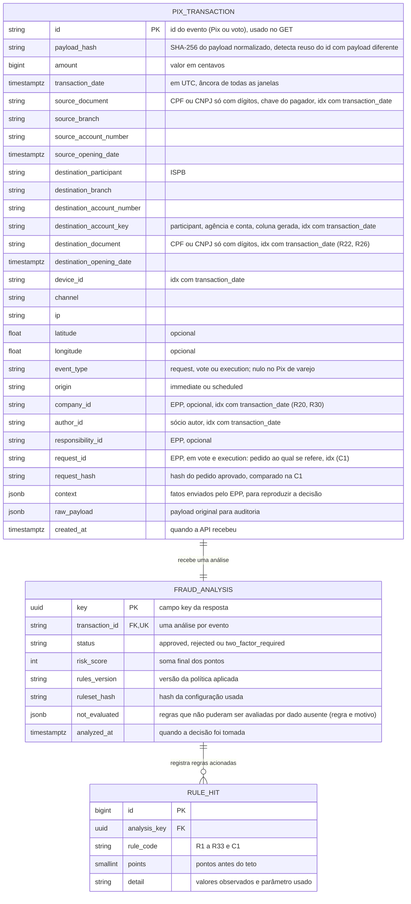

# RFC — Motor antifraude Pix com regras pontuadas, histórico local e decisão idempotente

| | |
|---|---|
| **Time** | Grupo 27: Hugo Gomes · Leandro Apolinário Leite · Mateus Carósio |
| **Data** | 18/10/2026 |
| **Versão** | 7.3 |

## Contextualização

### Entendendo o problema

O sistema chamador envia cada pedido de Pix e o motor responde, antes do dinheiro sair e em poucos
segundos, `approved`, `two_factor_required` ou `rejected`, sem analista, sem consulta externa pesada
e sempre com um motivo explicável. Uma transação isolada diz pouco, então cada Pix é comparado com o
que o pagador, o destinatário e o dispositivo já fizeram. O chamador principal é a conta compartilhada
de EPP (empresa de pequeno porte com vários sócios): o dinheiro é da empresa, cada operação tem um sócio autor, e o risco inclui o golpe externo,
o sócio malicioso, os sócios coniventes, a sessão sequestrada e o contorno dos controles internos; por
isso o motor também avalia votos de aprovação e pagamentos programados. Três erros custam caro: aprovar uma fraude libera
um dinheiro difícil de recuperar; barrar um cliente bom (o aluguel pago pela primeira vez a um novo
locador, a folha do mês) gera fricção e prejuízo; e o mesmo evento receber duas decisões, ou uma
rajada paralela passar sem ser vista porque cada requisição leu um histórico incompleto. Todo evento
válido e toda análise ficam gravados e consultáveis (a requisição recusada na validação, `400` ou
`422`, não vira evento). **Fora do escopo:** onboarding e cadastro de contas,
front-end, outras APIs, movimentar dinheiro, aplicar a decisão (quem exige o segundo fator ou a
aprovação adicional é o chamador), regra de saldo no Pix de varejo (o payload dele não traz saldo),
machine learning, a governança do quórum (a entrega e a contestação dos avisos aos sócios são decisão de produto; o motor só recomenda o aviso e o canal mínimo, o celular) e a
comunicação de operações suspeitas, que é do compliance.

### Explicando a solução de forma macro

A API valida e normaliza o evento, trava as chaves envolvidas (o próprio `id`, o pagador e a conta
destino) dentro de uma transação PostgreSQL, lê o histórico local já gravado, junta os fatos que só o
EPP conhece (saldo livre, limites, ativação da conta, mudanças de controle), confere a integridade
entre pedido, voto e execução (C1), avalia 33 regras determinísticas (R1 a R12, R28, R29 e R33 de Pix; R13 a
R27 e R30 a R32 do contexto EPP) e soma pontos. Cada regra é uma função
pura (evento + contexto de histórico → pontos e detalhe), o que permite testá-la sem banco; as
camadas seguem o Base Service (rota, serviço, repositório). Os limites em reais acompanham o cliente: o valor que o motor considera alto sai do histórico do próprio pagador (mediana, maior valor já pago a cada contraparte, média diária da empresa), e valor fixo só serve de piso de ruído ou de ponto de partida para quem ainda não tem histórico. A soma vira o status por faixas, com tetos
para famílias de sinais correlacionados, de modo que valor alto, ou sinais de sessão, sozinhos nunca
reprovam. Evento, análise e regras acionadas são gravados na mesma transação de banco. O `id` do
evento (o Pix ou o voto) é a chave de idempotência, e o `payload_hash` distingue reenvio legítimo de
reuso indevido do `id`. O contrato do desafio não muda: o payload de exemplo, sem `context`, é aceito e
analisado só pelo núcleo; o `context` é uma extensão opcional da entrada.

- **Decidir por regra isolada (a primeira que casa decide, ou qualquer alerta reprova)** —
  descartada porque perde contexto (três sinais moderados juntos valem mais que cada um sozinho) e
  dispara falsos positivos, travando quem só quer pagar. Ganharia se o cliente exigisse bloqueios
  categóricos, como lista de contas proibidas, ou se a perda média por fraude fosse muito maior que o
  custo de fricção, como em contas já marcadas como de alto risco.
- **Consultar bases externas a cada Pix** — descartada porque a latência e a dependência externa
  quebram o "poucos segundos". Ganharia se houvesse uma base de reputação com SLA em milissegundos ou
  cache local confiável.
- **Modelo de machine learning** — descartado porque exige dados rotulados de fraude confirmada,
  avaliação e monitoramento que não existem aqui. Ganharia com esse histórico rotulado; as regras
  gravadas por evento servem de base auditável para isso.
- **Contadores em memória (Redis) ou isolamento `SERIALIZABLE` em vez de lock consultivo** —
  descartados porque o primeiro cria uma segunda fonte de verdade fora do banco, que pode divergir
  do histórico gravado, e o segundo faz requisições concorrentes falharem e exigirem retentativa.
  Ganhariam se o volume exigisse latência abaixo do que o PostgreSQL entrega ou se as regras só
  precisassem de contadores aproximados.
- **Bloquear em tempo real os padrões de lavagem de dinheiro (giro de dias, ciclos entre contas)** —
  descartado nesta versão porque esses padrões são lentos e têm alto risco de falso positivo, e a decisão de
  comunicar uma operação suspeita é do compliance, não do motor. Viram alertas de 0 ponto para o
  back-office (roadmap). Ganhariam com uma base de casos confirmados para calibrar o corte entre alerta
  e bloqueio.

- **Régua fixa de valor para todos os clientes (pontuar ou bloquear acima de R$ X)** — descartada porque o mesmo
  valor é rotina para uma empresa e anomalia para outra (R$ 40.000 é o fornecedor mensal de uma e o desvio de
  outra): trava o cliente grande ou deixa passar o pequeno. Ganharia se todos os clientes tivessem porte
  parecido; hoje sobra como piso de ruído e como ponto de partida de quem não tem histórico.
- **Z-score (desvio padrão) sobre o histórico do cliente** — descartado porque, com 20 Pix por pagador, o desvio
  padrão é instável e um único valor atípico o infla, o mesmo defeito que a mediana evita; e "3 desvios" é mais
  difícil de explicar na auditoria que "5× a mediana". Ganharia com centenas de Pix por pagador, na versão
  robusta (MAD sobre o logaritmo do valor).
- **Segmentação por setor (MCC no cartão; no CNPJ, o CNAE) e comparação com os pares** — descartada nesta versão
  porque o contrato do Pix não traz o setor, o cadastro está fora do escopo e o grupo de pares de um cliente novo
  é pequeno e enviesado. Ganharia como alerta de 0 ponto (A7 no roadmap) quando a plataforma tiver o CNAE e pares
  suficientes por setor.
- **Faturamento declarado no cadastro para afrouxar o limite geral** — descartado porque quem abre a conta
  controla o número: declarar muito seria pedir licença para movimentar muito. Valor declarado isolado só pode
  apertar, como alerta de 0 ponto (A4). Na v7.3, valores corroborados por evidências recentes entram apenas na
  aprovação de um perfil operacional delimitado para R24; não alteram o limite comportamental geral nem
  substituem as outras regras.

## Implementação

### Rotas

| Método | Caminho | O que faz | Entrada (campos que importam) | Saídas (status e quando) |
|---|---|---|---|---|
| `POST` | `/pix/transaction` | Valida, analisa, grava e devolve a decisão. **Idempotente:** `id` do evento (Pix ou voto) com `UNIQUE` no banco + `payload_hash` do payload normalizado. | `id`; `amount` (centavos); `transaction_date` (com fuso); `source_account.owner.document_number` e `opening_date`; `destination_account` (`participant`, `branch`, `account_number`, `owner.document_number`, `opening_date`, opcional no EPP); `source.device_id`, `channel`, `ip`, `geolocation` (opcional). **`context` (opcional, enviado pelo EPP):** `event` (`request`, `vote`, `execution`), `origin` (`immediate`, `scheduled`), `company_id`, `author_id`, `responsibility_id` e os fatos que só o EPP conhece; `request_id` e `request_hash` são obrigatórios em `vote` e `execution`; `credential_changed_at` e `destination_partner_documents` são opcionais. Para perfil operacional autorizado, o pedido inclui `operational_profile` com três evidências verificadas de porte, faturamento mensal e número de funcionários, além de limites por pagamento/lote, `batch_id`, `batch_total_cents` e `beneficiary_authorized`; a execução envia `operational_profile_ref` e o mesmo lote/total, conforme o contrato abaixo. | `201` análise criada, com `key`, `status` e `metadata` (`risk_score`, `reasons`, `rules_version`, `ruleset_hash`, `recommended_actions`, `not_evaluated` e, quando aplicável, `operational_profile`); `200` mesmo `id` e mesmo payload: devolve a análise já gravada, sem reprocessar; `400` corpo ilegível ou JSON malformado; `409` mesmo `id` com payload diferente; `422` campo ausente ou de tipo errado, `amount` não inteiro ou ≤ 0, data sem fuso, documento sem 11 ou 14 dígitos, latitude ou longitude fora da faixa, `context` com `event` inválido ou sem `author_id`, ou `vote`/`execution` sem `request_id` e `request_hash`; `500` falha interna: tudo é revertido e o reenvio é seguro |
| `GET` | `/pix/transaction/{id}` | Devolve o evento Pix armazenado e sua análise (somente leitura). `{id}` é o `id` do evento, não o `key`. | `id` na URL | `200` `key`, `status`, `metadata` e `transaction` com o payload gravado; `404` quando o evento não existe |

### Banco de Dados (Somente diagrama)

### Fluxos

**POST `/pix/transaction` — caminho feliz**

1. Validar a requisição (`400`/`422`) e normalizar: documentos só com dígitos, datas em UTC,
   geolocalização opcional, bloco `context` quando existir. Calcular o `payload_hash` sobre o payload
   normalizado.
2. Abrir a transação PostgreSQL e obter `pg_advisory_xact_lock` sobre três chaves, sempre na mesma
   ordem (`id`, pagador, conta destino) para evitar deadlock. Os locks caem no commit.
3. Buscar o `id`. Se existir com o mesmo hash, devolver `200` com a análise existente. Se o hash for
   diferente, devolver `409`. Nos dois casos, nada é reprocessado.
4. Carregar o contexto de histórico com consultas agregadas e indexadas e juntá-lo ao `context` do EPP.
   As janelas são relativas à `transaction_date` do próprio evento, usam só registros com data menor ou
   igual a ela e excluem o próprio `id`.
5. Rodar a checagem C1 (só em `vote` e `execution`), executar as regras aplicáveis de R1 a R33 em ordem
   fixa, aplicar modificadores e tetos, somar e mapear a faixa em `status`; se a C1 for acionada, o
   `status` é `rejected`.
6. Gravar `PIX_TRANSACTION`, `FRAUD_ANALYSIS` e `RULE_HIT` na mesma transação, fazer commit e devolver
   `201` com `key`, `status` e `metadata`.

**Contraparte recorrente e valor habitual** (v6; a mesma definição vale em todas as regras)

- **Recorrente:** o pagador (no EPP, a empresa) pagou o mesmo documento destino, com Pix não rejeitados,
  em ≥ 3 dias distintos, o mais antigo há ≥ 14 dias, antes da janela da regra.
- **Valor habitual:** o Pix é para uma contraparte recorrente e vale ≤ 120% do maior Pix não rejeitado
  anterior para ela.

A recorrência é fator de confiança, não imunidade:

| Sinal | Tratamento na v6 | Por quê |
|---|---|---|
| Valor habitual para contraparte recorrente | R1 vale 1 (em vez de 2); R4 e R30 não pontuam | Aluguel e fornecedor mensais não devem cair em 2FA todo mês |
| Salto de valor para a mesma contraparte (> 120% do maior anterior) | Sem redução: R1 e R4 valem como para qualquer destinatário | O reajuste de 10% passa; o salto de 30% é o sinal |
| Fracionamento (R29) | A isenção só vale se a soma da janela for ≤ 150% do maior Pix anterior; o R8 nunca é neutralizado | Recorrência não pode virar licença para dividir valor |
| Construir confiança com Pix pequenos | Não funciona: o teto é sobre o maior valor anterior | Três Pix de R$ 1 só deixam passar até R$ 1,20 |
| Crescimento progressivo (até +20% por passo) | Limitação conhecida, no roadmap | Cada passo continua habitual |
| Relação baseada só em pedidos | O motor aproxima "pagamento concluído" por "não rejeitado" (não recebe liquidação nem devolução); 3 dias distintos e 14 dias dificultam fabricar confiança | O resultado do pagamento é do sistema chamador |

**Início frio e perfil maduro** (v7; o cliente que ainda não tem histórico)

Sem volumetria, as regras relativas (mediana, média diária, valor habitual) não têm base. Até o cliente construir
histórico, o motor usa **degraus fixos**, e só deixa o limite acompanhar o cliente quando o perfil está maduro.

| Estágio | Critério (só o que o motor observou) | O que vale |
|---|---|---|
| **Frio** | Pagador com < 3 Pix não rejeitados | R4, R5 e R7 desligadas; L = R$ 5.000; degraus fixos: R10 (conta de até 30 dias), R33 (conta mais antiga, de R$ 2.000 a R$ 4.999,99) e R1 (a partir de R$ 5.000) |
| **Em formação** | De 3 a 9 Pix, ou 10 ou mais que ainda não cumprem os dias e a antiguidade do perfil maduro | R5 e R7 (≥ 3 Pix) e R4 (≥ 5 Pix) ligam; L continua R$ 5.000 e os degraus continuam |
| **Maduro** | ≥ 10 Pix não rejeitados, em ≥ 5 dias distintos, o mais antigo há ≥ 14 dias; Pix para o próprio documento não contam | L relativo (3× a mediana); o R33 desliga |
| **EPP, frio ou em formação** | Empresa ativada há ≤ 30 dias, ou com < 10 saídas | R30 não avalia; o R24 aplica o degrau (R$ 5.000 vale 1; R$ 20.000 vale 2), exceto operação agendada coberta por perfil operacional ativo, aprovado e documentado |
| **EPP, maduro** | Ativada há ≥ 30 dias e com ≥ 10 saídas | R30 avalia; o R24 desliga |

**Perfil operacional comprovado (v7.3).** A mediana de uma EPP recém-onboardada não representa sua folha nem os custos operacionais recorrentes. O EPP mantém um perfil versionado por empresa e responsabilidade para `operation_type=payroll` ou `operating_expenses`. O snapshot enviado no pedido agendado inclui `profile_id`, `version`, `status=active`, `company_id`, `responsibility_id`, `company_size`, `monthly_revenue_cents`, `employee_count`, `evidence`, `max_payment_cents`, `max_batch_cents`, `expires_at` e aprovações (`partner_id` + `approved_at`) de pelo menos dois sócios distintos do autor. Os limites por pagamento e lote são definidos pelo processo de aprovação do EPP; o motor não os infere nem os aumenta com base nos valores declarados.

O perfil exige três evidências verificadas, uma para cada dimensão (porte, faturamento mensal e quantidade de funcionários). Cada evidência informa `kind`, `reference_id`, `source`, `observed_value` e `verified_at`; o motor não recebe documentos brutos. As referências e origens devem ser distintas, o valor observado deve coincidir com o declarado no perfil e a verificação deve ter no máximo 90 dias. As aprovações e o perfil continuam válidos por no máximo 365 dias. Evidência ausente, repetida, vencida, futura ou divergente invalida a exceção da R24. Esses controles verificam a trilha declarada pelo serviço EPP; não provam a veracidade material do documento, que exige confrontar fontes independentes no onboarding.

Esse perfil só neutraliza a R24 para pedido/execução `scheduled` se o PIX estiver abaixo dos tetos por pagamento e lote e o beneficiário estiver autorizado pelo cadastro validado do EPP. Não substitui as demais regras nem o fluxo normal de aprovação. Na execução, o EPP envia `operational_profile_ref` com o mesmo ID/versão em estado ativo e os mesmos `batch_id`/`batch_total_cents`; o motor exige correspondência com o pedido gravado, incluindo valor, pagador, documento e conta destino, além de `request_id`/`request_hash` e ausência de execução anterior. Divergência, expiração ou revogação restabelece o degrau R24. O ID, a versão e o lote usados ficam em `metadata.operational_profile`; o snapshot completo de evidências e aprovações fica no `payload` JSONB do pedido para auditoria.

O motor não autentica votos nem administra perfis de folha. Esses fatos são atestados pelo serviço EPP, chamador autenticado pelo `INTERNAL-TOKEN`; esse segredo deve ser exclusivo do serviço EPP. O cadastro operacional principal e as aprovações ficam no EPP, e cada evento persistido no motor conserva a cópia recebida para reproduzir a decisão.

- **O perfil comportamental usa só o observado.** Faturamento, renda ou porte declarados no cadastro nunca
  entram na mediana nem elevam o limite geral: quem declara pode mentir. A exceção de início frio da folha é
  uma autorização operacional separada, aprovada por sócios, limitada por pagamento/lote, beneficiário e
  validade, e não altera o perfil comportamental. O motor usa os Pix que viu e as datas registradas pelo banco
  (`opening_date`, ativação); o declarado só aperta, como alerta de 0 ponto (A4).
- **Quem aperta usa histórico curto; quem afrouxa exige perfil maduro.** R4, R5 e R7 só somam pontos, então
  servem com 3 a 5 Pix. L e o valor habitual liberam valor, então exigem perfil maduro (o valor habitual já
  exige 3 dias distintos e 14 dias).
- **Por que contagem, dias e antiguidade:** só a contagem seria barata de fabricar (5 Pix em 5 minutos); dias
  distintos e antiguidade custam tempo. Pix para o próprio documento não contam. A limitação que sobra (perfil
  fabricado durante 14 dias com Pix a terceiros) está no roadmap, e o dano é limitado: L só sobe até 3× o que o
  histórico mostra e os demais sinais seguem somando.
- **Cliente que o motor nunca viu** (conta antiga, ou cliente de antes do motor) também é frio: é a idade do
  histórico que falta, não a da conta. O atrito é limitado, porque o degrau sozinho leva no máximo a 2FA.

**Limite do perfil (L) e pisos fixos** (v7; a mesma definição vale em R1, R3, R28 e R29)

- **L:** com perfil maduro (seção anterior), `L = max(R$ 5.000; 3 × mediana dos últimos 20 Pix
  não rejeitados)`; sem perfil maduro, `L = R$ 5.000`. No EPP o pagador é a empresa e a mediana é de todas as
  saídas dela (o R4 continua por `responsibility_id`).
- **Onde vale:** R1 (`amount` ≥ L), R3 (soma ≥ 2 × L), R28 (banda de 90% a 99,99% de L) e R29 (soma ≥ L).
- **Regra de desenho:** quando há histórico comparável, os limites acompanham o perfil. R4 usa 5× a mediana,
  R25 usa 3× a mediana das entradas em 24 h, R26 usa 3× a mediana dos totais recebidos pelo destino em 24 h,
  R20 mede a fração do saldo livre e R30 compara com a média diária. R9 segue fixo porque mede concentração
  por destino; o R24 também, porque vale para conta sem perfil maduro.
- **Por que isso não abre a porta:** a mediana resiste a um Pix atípico antigo; L sobe só até 3× o que o cliente
  já costuma pagar (o R4 pega a partir de 5×); e aparelho novo, contraparte nova e sinais de sessão continuam
  somando. Para quem costuma pagar R$ 4.000, o R1 passa a pontuar em R$ 12.000, não em R$ 5.000.
- **O que fica de fora:** faturamento declarado e setor (CNAE) só apertariam, em alerta de 0 ponto (A4, A7), e
  nunca afrouxariam L: quem abre a conta controla o que declara.

**Regras de Pix avaliadas no passo 5** (parâmetros iniciais, calibrados com os cenários de teste e
repetidos no README)

| Regra | Lógica e parâmetros | Pts | Por quê |
|---|---|---|---|
| **R1 Limite** | `amount` ≥ L (R$ 5.000 sem perfil); vale 1 se o valor é habitual para a contraparte recorrente | 2 (1 habitual) | Valor alto aumenta a exposição, mas não prova fraude: sozinho leva só a 2FA. R$ 5.000 é o ponto de partida de quem não tem perfil, e L sobe com a mediana do cliente (para quem costuma pagar R$ 4.000, o limite vira R$ 12.000); o aluguel mensal reajustado em até 20% vale 1, e um salto maior volta a valer 2. |
| **R2 Velocity** | ≥ 5 Pix do pagador em 60 s, contando o atual, qualquer status | 2 | Pessoa raramente faz 5 Pix por minuto; script faz. Conta tentativas rejeitadas, porque a rajada é o sinal. |
| **R3 Montante acumulado** | Soma do pagador em 10 min ≥ 2 × L (R$ 10.000 sem perfil), com pelo menos 2 Pix na janela | 2 | Pega valor fatiado que escapa do R1. 2 × L é o dobro do limite do R1, então quem fatia precisa ultrapassar bastante o limite individual; e a empresa de mediana R$ 8.000 que paga dois fornecedores de R$ 9.000 em minutos não está fatiando nada. Exigir 2 Pix evita contar duas vezes um único Pix grande. |
| **R4 Desvio de perfil** | `amount` ≥ 5× a mediana dos últimos 20 Pix não rejeitados do pagador, com histórico ≥ 5 e `amount` ≥ R$ 500; não pontua se o valor é habitual para a contraparte recorrente | 2 | A mediana resiste a valores atípicos; 5× evita oscilação normal; o piso evita disparar em valores pequenos; o histórico mínimo evita inventar perfil de cliente novo. |
| **R5 Contraparte nova** | Pagador sem Pix anterior para essa conta destino, com histórico ≥ 3 e `amount` ≥ R$ 1.000 | 1 | Destinatário novo é contexto, não motivo isolado. O histórico mínimo impede que o primeiro Pix de todo cliente pontue. |
| **R6 Destino recém-aberto** | Conta destino com ≤ 30 dias na `transaction_date`, medidos em tempo decorrido, e `amount` ≥ R$ 1.000 (se o R8 dispara, vale a soma da janela dele); sem `opening_date` do destino, não pontua | 2 | Contas recentes concentram risco de conta de passagem. 30 dias evita a fronteira apertada de 7 dias. |
| **R7 Dispositivo novo** | `device_id` fora dos dispositivos dos últimos 20 Pix não rejeitados do pagador, com histórico ≥ 3 e `amount` ≥ R$ 500 | 2 | Troca de aparelho é legítima, por isso só pontua com valor relevante e perfil existente. |
| **R8 Fracionamento** | ≥ 3 Pix do pagador para a mesma conta destino em 5 min, cada um < R$ 1.000, com soma ≥ R$ 2.000 | 2 | Detecta quem fica abaixo do piso do R6 dividindo o valor; por isso, quando dispara, o R6 olha a soma da janela e não cada Pix. |
| **R9 Destino concentrador** | Conta destino recebeu de ≥ 5 pagadores distintos em 60 min, com soma ≥ R$ 10.000, contando o atual; não vale para destinatário CNPJ com conta > 30 dias | 3 | Padrão de conta de passagem. 5 pagadores distintos em uma hora é incomum fora do comércio, e o piso de R$ 10.000 evita pontuar vaquinhas pequenas. A exceção protege comerciantes legítimos. |
| **R10 Pagador recente** | Conta pagadora com ≤ 30 dias e `amount` ≥ R$ 2.000; vale 2 se o pagador tem < 3 Pix no histórico | 1 (2 sem perfil) | Sinal complementar de idade da conta. 30 dias acompanha o R6; o piso é maior (R$ 2.000) porque conta nova, sozinha, não é suspeita. Sem 3 Pix de histórico, R4, R5 e R7 não avaliam e o R10 é a única proteção: por isso vale 2 e leva a 2FA (na v4, o primeiro Pix de R$ 4.900 de uma conta de 10 dias saía `approved`). |
| **R11 Deslocamento impossível** | Com geolocalização nos dois Pix, o Pix anterior do pagador foi há ≤ 60 min, a distância é ≥ 50 km e a velocidade implícita é > 900 km/h | 3 | Sugere sessão usada de outro lugar. 900 km/h é a ordem de um voo comercial; 50 km filtra ruído de GPS. Sem geolocalização, não pontua. |
| **R12 Dispositivo compartilhado** | Mesmo `device_id` usado por ≥ 3 documentos pagadores distintos em 24 h | 2 | Um aparelho servindo várias titularidades sugere fazenda de contas. 3 documentos deixa de fora o aparelho dividido por duas pessoas (casal, família). |
| **R28 Valor colado no piso** | ≥ 3 Pix do pagador em 24 h, contando o atual e qualquer status, cada um entre 90% e 99,99% de L (R$ 4.500 a R$ 4.999,99 sem perfil) | 2 | O R1 é um degrau: logo abaixo de L vale 0 e em L vale 2 (sem perfil, R$ 4.999 e R$ 5.000), e quem conhece o limite fica logo abaixo. Um Pix assim é normal; três no mesmo dia são teste. Entra na família de valor. |
| **R29 Fracionamento por documento** | ≥ 4 Pix do pagador para o mesmo documento destino (qualquer conta) em 60 min, contando o atual, soma ≥ L (R$ 5.000 sem perfil), sem teto por Pix; não vale para destinatário recorrente se a soma da janela for ≤ 150% do maior Pix anterior para ele | 2 | O R8 só vê a mesma conta, 5 min e Pix < R$ 1.000: seis Pix de R$ 1.499 passavam por R2, R3 e R8. 4 Pix em 1 h separam fracionamento de duas ou três compras seguidas; L é o limite do R1, então dividir para fugir dele é o caso. Compartilha teto com o R8. A recorrência isenta o pagamento habitual, não o fracionamento. |
| **R33 Degrau de início frio** | Pagador sem perfil maduro, conta com > 30 dias na `transaction_date` e `amount` de R$ 2.000 a R$ 4.999,99; não pontua se o valor é habitual para a contraparte recorrente | 1 | O R10 só cobre conta de até 30 dias e o R1 só começa em R$ 5.000. Conta antiga que o motor ainda não conhece (dormente, ou cliente de antes do motor) ficaria sem sinal de valor nessa faixa, com R4, R5 e R7 desligados. O degrau vale 1: sozinho aprova, mas soma com outro sinal fraco. R$ 2.000 é o piso do R10. |

**Ajustes de R1 a R12, R28, R29 e R33 quando há `context`** (sem `context`, as regras valem como estão)

| Regra | No EPP | Por quê |
|---|---|---|
| **R1 Limite** | **Não avalia** | O limite do sócio e a regra de aprovação já controlam o valor, e pagar fornecedor acima de R$ 5.000 é rotina de empresa. R4, R13 e R20 cobrem o desvio. |
| **R2 Velocity** | Igual; execução `scheduled` não pontua | A folha em lote é uma rajada legítima, já aprovada. |
| **R3 Montante acumulado** | **Adaptada:** soma ≥ 2 × L da empresa (mediana de todas as saídas dela); execução `scheduled` não pontua | Mesmo motivo do R2; e a empresa que paga dois fornecedores grandes em minutos não pode cair em 2FA todo dia por causa de um piso de R$ 10.000. |
| **R4 Desvio de perfil** | **Adaptada:** mediana e histórico mínimo por `responsibility_id` do pedido, quando houver; o valor habitual de contraparte recorrente também não pontua | Folha e despesa pequena não dividem a mesma mediana; o perfil de uma empresa só faz sentido por responsabilidade. |
| **R5 Contraparte nova** | Igual; execução `scheduled` não pontua | Fornecedor novo é rotina; o R23 trata o caso específico da responsabilidade. |
| **R6 Destino recém-aberto** | Igual | Conta de passagem é risco para qualquer pagador. |
| **R7 Dispositivo novo** | **Não avalia** (vale o R17) | Conta compartilhada tem vários sócios, cada um com seus aparelhos; o histórico por conta geraria falso positivo. |
| **R8 Fracionamento** | Igual | Fugir do limite do sócio também é fracionar; o R13 pega o valor colado ao limite. |
| **R9 Destino concentrador** | **Não avalia** (vale o R26) | Os "pagadores distintos" do EPP são empresas, e o R26 é a mesma regra com janela de 24 h. |
| **R10 Pagador recente** | **Não avalia** (vale o R24) | A idade da conta pagadora é a ativação, e o R24 já a mede. |
| **R11 Deslocamento impossível** | **Não avalia** (vale o R18) | Dois sócios em cidades diferentes são normais; só faz sentido por autor. |
| **R12 Dispositivo compartilhado** | **Adaptada:** ≥ 3 `author_id` distintos, de empresas diferentes, em 24 h | Sócios da mesma empresa no computador do escritório, ou um sócio com várias empresas, não são fazenda de aparelhos. |
| **R28 Valor colado no piso** | **Não avalia** (vale o R13) | O R1 não existe no EPP, então não há piso para colar; o teto que importa é o do sócio, que o R13 mede. |
| **R29 Fracionamento por documento** | Igual, com o L da empresa | Fracionar entre contas do mesmo titular é risco para qualquer pagador. |
| **R33 Degrau de início frio** | **Não avalia** (vale o R24) | O degrau do EPP já é o R24, com os valores de empresa. |

**Regras do contexto EPP avaliadas no passo 5** (R13 a R27 e R30 a R32; só quando há `context`; o "autor" é o sócio que
criou o pedido; "recorrente" segue a definição de valor habitual acima, com a empresa como pagadora)

| Regra | Lógica e parâmetros | Pts | Por quê |
|---|---|---|---|
| **R13 Valor colado no limite** | ≥ 3 pedidos do autor em 24 h, cada um entre 90% e 99,9% do menor valor entre o limite do autor e o gatilho de aprovação; não conta recorrente | 2 | Quem testa o controle repete valores logo abaixo dele; mensalidade fixa não é teste. |
| **R14 Recriação após recusa** | Pedido do autor para a mesma contraparte com valor de 80% a 120% de um pedido dele recusado por outro sócio em ≤ 24 h; cancelamento pelo autor não conta | 2 | A recusa é sinal de controle interno que o Pix de varejo não tem. |
| **R15 Aprovação disfarçada** | No evento `vote`: mesmo `device_id` do autor do pedido, ou mesmo IP e voto em < 10 s da criação | 3 | Quórum exige pessoas distintas; o EPP só barra o autor votando em si. IP sozinho é fraco (mesmo escritório). |
| **R16 Afrouxamento de controle seguido de uso** | Em ≤ 24 h depois de elevar limite, criar permissão, afrouxar regra de aprovação, definir substituto, remover ou incluir sócio ou reduzir o quórum, o pedido só passa por causa disso; ignora empresa com < 7 dias de conta | 3 | Mexer nos controles pouco antes de usar é o padrão de abuso de um sistema de controles configuráveis. Tirar um sócio ou baixar o quórum antecede o desvio entre sócios coniventes. |
| **R17 Dispositivo novo do sócio** | R7 pelo histórico do autor (não da conta): `device_id` fora dos últimos 20 pedidos não rejeitados dele, histórico ≥ 3, valor ≥ R$ 500 | 2 | Numa conta compartilhada, cada sócio tem seus aparelhos. |
| **R18 Deslocamento e IP do sócio** | R11 por autor, janela ≤ 12 h; sem geolocalização, país do IP (base local) diferente do último IP do autor | 3 | Sessão usada de outro lugar; a janela maior cobre voos longos. |
| **R19 Horário atípico** | Pedido imediato criado entre 0h e 5h (fuso do Brasil), valor ≥ R$ 1.000, autor com ≥ 10 operações e nenhuma nesse horário | 1 | Usa a hora de criação, nunca a da execução, para não punir pagamento agendado. |
| **R20 Esvaziamento** | Saídas pagas com saldo livre nas últimas 24 h, contando a atual, somam ≥ 70% do saldo livre anterior à primeira delas (saldo livre antes do pedido + saídas livres anteriores da janela) e ≥ R$ 5.000; pagamento coberto por reserva de responsabilidade não conta | 2 | Folha e imposto saem de reserva por desenho; saldo livre drenado é o sinal. Medir só por evento deixava passar três saídas de 60% do saldo restante (cerca de 94% drenado sem acionar nada); acumulado em 24 h, a segunda (84%) já dispara. |
| **R21 Liberação de reserva seguida de saída** | Liberação ou transferência entre reservas e, em ≤ 30 min, saída do autor ≥ 80% do liberado para contraparte nova | 3 | Tira da empresa o dinheiro de impostos ou folha. |
| **R22 Destino é sócio** | Contraparte com o CPF de um sócio, valor ≥ R$ 2.000; não vale para recorrente com valor ±20% (pró-labore) | 1 | O dinheiro é da empresa, não dos sócios; isolada pesa pouco, soma com R13, R15 ou R20. |
| **R23 Contraparte nova para a responsabilidade** | Responsabilidade com ≥ 5 pagamentos e ≤ 3 contrapartes em 90 dias recebe pedido de contraparte nunca paga por ela, valor ≥ R$ 1.000 | 1 | Responsabilidade previsível (impostos) pagando destino fora do padrão. Não soma com o R5: o mesmo fato não conta duas vezes. |
| **R24 Conta recém-ativada com saída grande** | Empresa sem perfil maduro (ativada há ≤ 30 dias, ou com < 10 saídas): saída externa ≥ R$ 5.000 vale 1; ≥ R$ 20.000 vale 2. Não pontua para folha `scheduled` coberta pelo perfil ativo e aprovado da seção de início frio | 1–2 | Usa a ativação, não o cadastro. O perfil versionado evita comparar a primeira folha com uma mediana inexistente; limites, beneficiário autorizado, duas aprovações e conferência exata na execução impedem a isenção genérica de qualquer saída grande. |
| **R25 Passagem entrada → saída** | Entradas externas em 24 h ≥ 3× a mediana das entradas externas em janelas de 24 h dos 30 dias anteriores; saída ≥ 80% delas em ≤ 2 h para contraparte nova, em empresa ativa há ≤ 90 dias ou só com pagadores novos. O EPP envia `context.inflows_24h_median`; sem mediana positiva, não avalia | 3 | Compara o fluxo com o histórico da empresa, sem piso monetário fixo. Calibrar primeiro, pois é a regra de maior risco de falso positivo. |
| **R26 Destinatário em rede** | Mesmo documento de contraparte recebendo pedidos de ≥ 4 empresas em 24 h; total atual ≥ 3× a mediana dos totais recebidos em janelas de 24 h nos 30 dias anteriores, calculada em dias ativos com pelo menos 5 janelas; não vale se for recorrente para a empresa atual | 3 | A plataforma enxerga várias empresas. A mediana compara o destino com a própria atividade recente; revisar a base legal (LGPD) e consultar por hash do documento. |
| **R27 Sócio de muitas empresas (alerta)** | Mesmo CPF de sócio (`partner_documents`) em ≥ 3 `company_id` distintos com eventos nos últimos 30 dias, contando o atual | 0 | Só alerta, em `reasons`, para o back-office; não altera o status. Usa a atividade que o motor viu, não o cadastro, que está fora do escopo. |
| **R30 Saída da empresa fora do padrão** | Saídas livres da empresa em 24 h (contando a atual; exclui pagamento coberto por reserva, execução `scheduled` e Pix de valor habitual para contraparte recorrente) ≥ 3× a média diária aparada dos 30 dias anteriores à janela (soma das saídas livres sem o dia de maior saída, dividida por 29; dia sem saída conta zero) e ≥ R$ 10.000; empresa ativada há ≥ 30 dias e com ≥ 10 saídas no período | 2 | R13, R14 e R17–R19 olham um autor por vez e o R3 só olha 10 min: quatro sócios abaixo do próprio limite passavam. É o único sinal que não depende de quem pede. 3× filtra a oscilação de fim de mês; o piso evita empresa pequena; sem 30 dias não há média confiável. Sem excluir o valor habitual, o fornecedor mensal passaria de 3× a média diária todo mês. A média é aparada para que um único dia atípico no passado não infle a linha de base e deixe passar o desvio. |
| **R31 Destino ligado a sócio** | Contraparte é CNPJ do qual um sócio da empresa também é sócio, ou CPF de sócio de outra empresa da plataforma (`destination_partner_documents`, quando a plataforma conhece a contraparte); valor ≥ R$ 2.000; não vale para recorrente com valor ±20% | 2 | Desviar para a segunda empresa do mesmo sócio contorna o R22, que só compara CPF. Pesa mais que o R22 porque exige vínculo comprovado. R22 e R31 são o mesmo fato e compartilham teto. |
| **R32 Credencial trocada seguida de saída** | Em ≤ 24 h depois de `credential_changed_at` do autor, pedido imediato ≥ R$ 2.000; ignora autor com credencial criada há < 7 dias | 2 | Precursor clássico de tomada de conta, que não era visto: o R16 olha controles da empresa, não credenciais do sócio. Entra na família de sessão (teto 4), então não reprova sozinho. |

**Checagem de integridade C1** (só `vote` e `execution`; não pontua)

| Checagem | Lógica e parâmetros | Efeito | Por quê |
|---|---|---|---|
| **C1 Pedido, voto e execução (v2)** | `request_id` e `request_hash` obrigatórios (`422` se faltarem). Pedido inexistente, `rejected` ou com hash diferente; em `execution`, também compara valor, pagador, conta pagadora, documento e conta destino com o pedido armazenado. Uma segunda execução não rejeitada para o mesmo pedido é inválida (parcelas fora do escopo). | `rejected`; `RULE_HIT` `C1` com 0 pontos e o motivo | A execução precisa repetir o pagamento que foi pedido. A C1 v2 confere os campos financeiros além do vínculo por hash, então uma divergência não recebe a isenção de agendamento nem passa como execução autorizada. |

**Combinação e faixas** (a C1 roda primeiro e, se acionada, força `rejected`; as regras aplicáveis rodam
em ordem fixa, sem short-circuit; a ordem só estabiliza a lista de motivos, e cada regra acionada gera
um `RULE_HIT` com os pontos antes do teto)

- **Tetos por família**, para o mesmo ato não contar várias vezes: **3 pontos** para valor
  (R1 + R3 + R4 + R28), **2** para fracionamento (R8 + R29), **3** para controles internos
  (R13 + R14 + R16), **4** para sessão do sócio (R17 + R18 + R19 + R32) e **2** para destino ligado a
  sócio (R22 + R31), de modo que sinais de sessão sozinhos nunca reprovam.
- **Faixas:** **0–1** `approved`; **2–4** `two_factor_required`; **≥ 5** `rejected`. Como valor alto
  soma no máximo 3, reprovar exige pelo menos 2 pontos de outros sinais.
- **Autorreferência:** se `source_document` = `destination_document`, R5, R6 e R9 não pontuam.
- **Pagamento programado:** a execução pelo agendador (`event` = `execution` e `origin` = `scheduled`)
  não pontua R2, R3, R5 nem R17 a R19. O pedido que cria o agendamento (`request`) passa pelas outras
  regras. A R24 também não pontua quando a operação agendada está coberta por perfil operacional ativo e aprovado,
  dentro dos limites por pagamento e lote, e a execução corresponde exatamente ao pedido. Sem esse perfil,
  se ele vencer/for revogado ou houver divergência, a R24 normal de início frio continua valendo. A C1 e as
  demais regras permanecem ativas.
- **Quem aplica a decisão:** no EPP, `two_factor_required` pode virar segundo fator do autor ou
  aprovação adicional de outro sócio, e `rejected` em um voto significa que o voto não conta. Quem
  aplica é o EPP. Em evento EPP com status diferente de `approved`, se R15, R16, R20, R21, R22, R30, R31 ou R32 for acionada (ou a C1, por pedido ausente, rejeitado ou `request_hash` diferente), `metadata.recommended_actions` traz `notify_all_partners_mobile`: o EPP avisa **cada sócio pelo celular dele**, inclusive os que não votaram, antes de liberar o dinheiro. E-mail nunca é o único canal, porque quem controla uma caixa de e-mail (a do autor, a da empresa ou a de outro sócio) controla o que os demais veem. O contrato do aviso está abaixo. O detalhe de `reasons` não deve ser
  exibido ao cliente final, porque parâmetros revelados ensinam a ficar abaixo deles.
- **Regra não avaliada:** regra *não acionada* foi avaliada e não disparou; regra *não avaliada* não rodou
  por falta de dado (R6 sem data de abertura do destino, R11 com Pix anterior em ≤ 60 min mas sem
  geolocalização em um dos dois, R20 sem saldo livre, R24 e R30 sem data de ativação). Vai em
  `metadata.not_evaluated` com o motivo, é gravada com a análise e nunca soma pontos nem rejeita. Campo
  obrigatório ausente continua sendo `422`.
- **Histórico:** o de confiança (R4, R5, R7, R17) exclui apenas Pix `rejected`: o motor não recebe o
  resultado do 2FA, e contar só os `approved` faria o cliente do aluguel cair em 2FA todo mês. O de
  rajada e concentração (R2, R3, R8, R9, R11, R12, R28, R29) conta qualquer status.
- **Exemplos:** o cliente com mediana de R$ 200 que paga R$ 6.000 pela primeira vez a um locador, no
  aparelho de sempre, soma 3 (valor, já com o teto) + 1 (R5) = 4 e recebe 2FA. Já a sessão sequestrada
  de um sócio, com aparelho nunca visto (2), às 2h10 (1) e saída de 87% do saldo livre (2), soma 5 e é
  rejeitada. Uma conta de 10 dias que faz o primeiro Pix de R$ 4.900 soma 2 (R10 sem perfil) e recebe 2FA.
  Numa empresa de 4 sócios, uma saída de R$ 40.000 (mais de 3× a média diária) para o CNPJ de outro
  sócio soma 4 (R30 + R31), recebe 2FA e `notify_all_partners_mobile`; com o quórum reduzido 6 h antes, o R16
  soma 3 e o total é 7: rejeitada. O aluguel mensal de R$ 6.000 ao mesmo locador (4 dias distintos, o mais
  antigo há 3 meses), no aparelho de sempre, tem valor habitual: R1 vale 1 e R4 não pontua, 1 ponto,
  `approved`; reajustado em 30% (R$ 7.800), volta a valer R1 (2) + R4 (2), teto 3: 2FA. A folha agendada
  coberta por reserva e o fornecedor mensal recorrente de R$ 40.000 saem com 0 ponto. O cliente de perfil maduro e mediana R$ 4.000 que paga R$ 9.000 a um locador novo tem L = R$ 12.000: o R1 não pontua e só o R5 soma, 1 ponto, `approved` (com limite fixo seriam 3 pontos e 2FA). O mesmo cliente, de um aparelho nunca visto, a um destino novo, com R$ 11.500, soma R5 (1) + R7 (2) = 3 e recebe 2FA: subir o limite com o perfil não abre a porta para a sessão sequestrada. A empresa de perfil maduro e mediana R$ 8.000 que paga em 8 min dois fornecedores recorrentes de R$ 9.000 soma R$ 18.000, abaixo de 2 × L (R$ 48.000): o R3 não dispara. No início frio, a conta de 2 anos que o motor nunca viu e paga R$ 3.000 a um destino novo soma 1 (R33), `approved`; com R$ 6.000 soma 2 (R1, com L = R$ 5.000), 2FA. Quem fabricou 5 Pix de R$ 4.000 em 1 h e depois paga R$ 11.500 a um destino novo ainda não tem perfil maduro: L = R$ 5.000, R1 (2) + R5 (1) = 3, 2FA.

**Aviso aos sócios pelo celular** (v7; o motor não envia nada, porque não faz consulta externa: só recomenda `notify_all_partners_mobile`, e o EPP cumpre o contrato abaixo)

Um sócio fraudulento pode entrar na caixa de e-mail da empresa (ou de outro sócio), ler, apagar ou encaminhar o aviso e impedir que os demais saibam. O aparelho de cada sócio, protegido por biometria ou PIN próprios, não está ao alcance desse atacante.

| Requisito | O que o EPP faz | Por quê |
|---|---|---|
| Canal principal | Push no app instalado no aparelho vinculado a cada sócio, com texto genérico (sem valor nem destino na tela de bloqueio) | Cada sócio tem o próprio aparelho, protegido por biometria ou PIN; não há caixa de e-mail para interceptar |
| Reserva | Sem entrega do push em poucos minutos, SMS ao número cadastrado do sócio, com texto curto, sem link e sem valor ("há uma operação da sua empresa aguardando sua ciência; abra o app") | O SMS não leva link que possa ser falsificado; a troca de chip é um risco conhecido, por isso é só reserva |
| Contato anterior | Se o e-mail, o telefone ou o aparelho de qualquer sócio mudou nas últimas 72 h, o aviso vai também para o contato anterior à troca | Quem tenta calar um sócio costuma trocar o contato dele antes |
| E-mail | Só como cópia; nunca é o único canal e nunca confirma nem contesta | Quem controla a caixa de e-mail lê, apaga ou encaminha o aviso |
| Todos os sócios | Inclui quem não votou; o autor não dispensa, não confirma nem marca como lido o aviso dos outros | O ataque é deixar um sócio de fora (A6 no roadmap) |
| Contestação | No app, com a autenticação do próprio sócio; uma contestação segura o pagamento | Contestar por link de e-mail devolveria o problema |
| Registro | Por sócio: enviado, entregue e lido, com hora | Prova de quem foi avisado |
| Falha de entrega | Sócio sem entrega por nenhum canal não conta como ciente; o pagamento segue retido até a entrega ou até o fim da janela de contestação que o produto definir | Falha de canal não pode virar silêncio de concordância |

O mesmo vale para as mudanças de controle e de credencial (quórum, quadro de sócios, limites, e-mail, telefone):
o EPP avisa todos os sócios pelo celular no momento em que acontecem, e não só quando há um Pix, porque o motor
só enxerga o Pix.

**POST `/pix/transaction` — falha: mesmo `id` em duas requisições simultâneas**

1. As duas requisições disputam o lock do `id`; a segunda espera.
2. Quando a primeira faz commit, a segunda segue, encontra o `id` gravado e compara o hash: mesmo hash
   devolve `200` com a decisão gravada; hash diferente devolve `409`.
3. Se um bug furar o lock, a restrição `UNIQUE` de `id` e `transaction_id` rejeita o segundo `INSERT`.
   A requisição faz rollback, relê o registro e trata como reenvio. Nunca existem duas análises.

**POST `/pix/transaction` — falha: rajada paralela do mesmo pagador**

1. Cinco Pix diferentes do mesmo pagador chegam juntos. Sem lock, cada um leria um histórico vazio e o
   R2 nunca dispararia.
2. O lock por pagador faz as requisições passarem uma de cada vez. Cada uma enxerga o que as
   anteriores já gravaram, e a quinta vê 4 anteriores mais o atual: o R2 dispara.
3. A trava também cobre a conta destino, para o R9. O R12 e o R26 (janelas de 24 h) ficam sem trava:
   uma corrida de milissegundos quase não muda esses sinais.

**POST `/pix/transaction` — falha: voto vindo do aparelho do autor (EPP)**

1. O EPP envia o voto como evento `vote`, com o `device_id` do votante, e a requisição segue o mesmo
   caminho de lock e idempotência.
2. O R15 encontra o mesmo `device_id` do autor do pedido e soma 3 pontos.
3. O motor devolve `two_factor_required`: o EPP exige confirmação adicional do votante e só então
   conta o voto. Se o total chegar a 5, devolve `rejected` e o voto não conta para o quórum.

**POST `/pix/transaction` — falha: esvaziamento em fatias (EPP)**

1. Três saídas de 60% do saldo livre restante chegam em 24 h; cada uma, isolada, fica abaixo de 70%.
2. O R20 soma as saídas livres da janela sobre o saldo livre anterior à primeira: a primeira vale 60%
   (não dispara) e a segunda 84% (dispara, +2 e 2FA).
3. A leitura é consistente porque o pagador (a conta da empresa) está travado: cada saída enxerga as
   anteriores já gravadas. O mesmo vale para o R30.

**POST `/pix/transaction` — falha: execução diferente do aprovado (EPP)**

1. O EPP envia o voto e a execução com `request_id` e `request_hash`.
2. A C1 compara o hash com o do evento `request` gravado. Hash diferente, pedido ausente ou `rejected`
   devolve `rejected` e grava o `RULE_HIT` `C1` com 0 pontos.
3. O EPP não executa o pedido. As demais regras seguem rodando, só para registrar os motivos.

**POST `/pix/transaction` — falha: execução duplicada do mesmo pedido (EPP)**

1. Duas `execution` com `id` diferentes chegam para o mesmo `request_id`, ao mesmo tempo ou em sequência.
2. O lock do pagador (a conta da empresa) as serializa; a segunda enxerga a primeira já gravada.
3. A C1 encontra outra `execution` não rejeitada do mesmo `request_id` e devolve `rejected` na segunda,
   com `RULE_HIT` `C1` de 0 pontos. É uma execução por pedido; parcelas ficam fora do escopo. Reenviar a
   mesma execução com o mesmo `id` continua idempotente (`200`).

**POST `/pix/transaction` — falha: sócio fraudulento controla o e-mail (EPP)**

1. Um sócio, com acesso à caixa de e-mail da empresa, pede uma saída de R$ 40.000 para o CNPJ de outra empresa
   dele. O R30 (2) e o R31 (2) somam 4: `two_factor_required` e `notify_all_partners_mobile`.
2. O EPP manda push ao aparelho de cada um dos outros sócios e SMS se o push não for entregue; o e-mail vira só
   cópia. Quem controla a caixa de e-mail não consegue apagar nem encaminhar um aviso que está no celular de outra
   pessoa.
3. Qualquer sócio contesta no app e o pagamento fica retido. Um sócio sem entrega por nenhum canal não conta como
   ciente.

**Mapa de serialização (regra → chave)**

| Chave de serialização | Regras e checagens | Se houver corrida |
|---|---|---|
| Pagador (lock do documento do pagador; no EPP, a conta da empresa) | R1, R2, R3, R4, R5, R7, R8, R11, R13, R14, R15, R17 a R25, R28 a R31, R33 e C1 | Não passa: as requisições do mesmo pagador entram uma a uma |
| Conta destino (lock da conta destino) | R9 | Não passa |
| Nenhuma (janela de 24 h entre pagadores ou empresas) | R12, R26 e o alerta R27 | Pode passar; risco aceito e documentado, quarto lock no roadmap |
| Só o evento e o `context` | R6, R10, R16, R32 | Não há corrida: nada é lido do histórico |

A ordem de aquisição é sempre `id`, pagador, conta destino (evita deadlock). Um evento fora de ordem usa a
própria `transaction_date` e não enxerga os posteriores (limitação no roadmap). Cada chave com lock tem um
teste concorrente.

**GET `/pix/transaction/{id}` — caminho feliz e falha**

1. Buscar a análise pelo `id` do evento e devolver `key`, `status` e `metadata` (`200`).
2. Se não existir, devolver `404`, sem criar registro nem executar regras.

### Brechas analisadas e roadmap

A v5 nasceu de uma revisão da v4 atrás de cenários em que o motor deixava passar fraude. O README traz o
detalhe de cada parâmetro; aqui está o mapa.

| Brecha | Na v4 | Na v5 |
|---|---|---|
| Sócios coniventes (3 de 4) aprovando saídas de aparelhos distintos | Nenhuma regra por autor dispara; R22 só compara CPF | R30 (volume da empresa), R31 (destino ligado a sócio), R16 revisada (quadro e quórum), R32 e `notify_all_partners_mobile` |
| Esvaziar o saldo livre em fatias | R20 media cada saída isolada | R20 acumulado em 24 h |
| Dividir entre contas do mesmo titular, com Pix acima de R$ 1.000 | R8 exige mesma conta, 5 min e Pix < R$ 1.000 | R29 por documento, em 60 min |
| Ficar logo abaixo do piso de R$ 5.000 | R1 é um degrau | R28 |
| Conta nova sem histórico | R4, R5 e R7 desligam; R10 valia 1 | R10 vale 2 sem perfil |
| Agendamento como atalho | Isenção do `scheduled` ambígua | Isenção só na execução; a criação é avaliada por completo |
| Editar valor ou destino depois da aprovação | Nada ligava voto e execução ao pedido | C1 com `request_hash` |
| Tomada de conta por troca de credenciais | Não era sinal | R32 |

**Refinamentos da v6** (revisão externa da v5, aplicada no que cabe no escopo)

| Risco apontado | O que a v6 faz |
|---|---|
| Recorrência virava imunidade (R29) e não ajudava o aluguel legítimo (R1, R4) | Definição única de recorrente e de valor habitual; redução só para valor habitual; R29 e R30 com limites |
| Duas execuções do mesmo pedido, com `id` diferentes | C1 aceita uma execução por pedido |
| Regra que não rodava por falta de dado ficava silenciosa | `metadata.not_evaluated`, gravado com a análise |
| Chave de serialização de cada regra não estava escrita | Mapa regra → chave nos fluxos, com teste concorrente por chave |
| Testes só de fraude | Cinco cenários legítimos que precisam sair `approved` (no README) |

**Refinamentos da v7** (revisão da régua de valor e do canal de aviso)

| Risco apontado | O que a v7 faz |
|---|---|
| Régua fixa de valor: o mesmo R$ valia para todo cliente (R1, R3, R28 e R29; no EPP, dois fornecedores grandes em minutos caíam no R3) | Limite do perfil L (R$ 5.000 ou 3× a mediana, o maior) em R1, R28 e R29; R3 usa 2 × L; cada valor fixo é piso de ruído ou ponto de partida sem histórico |
| Um dia atípico no passado inflava a média diária do R30 e deixava passar o desvio | Média diária aparada (sem o dia de maior saída) |
| Sócio fraudulento controla o e-mail e esconde o aviso dos demais | `notify_all_partners_mobile`: push no aparelho de cada sócio, SMS de reserva, contato anterior à troca recente, e-mail só como cópia, o autor não controla a entrega; gatilhos ampliados (R15 e C1 por divergência) |
| Cliente sem histórico: a v7 anterior liberava o limite relativo com 5 Pix, e o início frio estava espalhado em mínimos de cada regra | Estágios frio, em formação e maduro; L relativo só com perfil maduro (10 Pix, 5 dias distintos, 14 dias); R33 (degrau de varejo) e R24 generalizada (degrau do EPP); nenhum dado declarado entra |
| Folha legítima de alto valor no início frio do EPP | R24 podia gerar atrito em pagamentos recorrentes de funcionários antes de haver histórico | R24 v2 aceita apenas perfil de folha versionado, com dois aprovadores, limites por pagamento/lote, beneficiário autorizado pelo EPP, validade máxima de 365 dias e execução idêntica ao pedido; C1 v2 confere os dados financeiros da execução |
| Z-score, setor e faturamento declarado como alternativas | Z-score descartado (20 Pix; um valor infla o desvio); setor (CNAE) vira alerta A7; faturamento declarado só aperta (A4), nunca afrouxa |

Ficaram de fora, de propósito: tabelas novas de pedido, voto, reserva e resultado de pagamento, `voter_id` e
validação de quórum, estados do pedido e histórico só com pagamento concluído. Pertencem ao sistema chamador
(EPP) ou exigem endpoints fora do escopo; o motor referencia o pedido por `request_id` e `request_hash`, sem
duplicar a fonte oficial.

**O que as regras não resolvem sozinhas.** Três sócios com credenciais válidas, votando em quórum válido,
não são identificáveis só por regras: o motor enxerga mudança de comportamento (R30, R31, R16), não
intenção. A proteção do sócio de fora é de produto (notificar todos os sócios pelo celular, e não só por e-mail, janela curta de
contestação, registro de entrega e leitura); o motor contribui com `notify_all_partners_mobile`. Se esse sócio
responde ou não perante a lei é questão de jurídico e compliance.

**Roadmap (nada disso está ativo).** Padrões de lavagem de dinheiro entram como alertas de 0 ponto
para o back-office, como o R27: giro de 7 dias (A1), ciclo A→B→A (A2), fan-out de contrapartes novas
(A3), porte incompatível com o faturamento declarado (A4), conta dormente (A5), quórum seletivo (A6) e desvio em relação aos pares do mesmo setor (A7, por CNAE). O faturamento declarado e o setor só apertam, em alerta de 0 ponto, e nunca afrouxam limite.
Além deles: lista local de partes sinalizadas, endpoint de resultado (2FA e devolução), quarto lock por
documento destino (o R26 é por documento e o lock por conta), validação do relógio do chamador, identidade do votante e validade do quórum (`voter_id`, hoje do EPP), e riscos que continuam
abertos (crescimento progressivo de valor, perfil fabricado durante 14 dias com Pix a terceiros, engenharia social, machine learning), além de importar o histórico anterior de clientes que o motor nunca viu.

> ## Principal desafio
>
> - **Qual é:** decidir de forma determinística a partir de um histórico que outras requisições estão
>   alterando ao mesmo tempo, sem punir o cliente legítimo.
> - **Por que é difícil:** velocity, montante e contraparte dependem de ler o que acabou de ser gravado,
>   e a rajada paralela, justamente o ataque que o R2 quer pegar, faz cada requisição ver um histórico
>   vazio. Do outro lado, sinais correlacionados somados jogam em `rejected` quem só paga o aluguel ou a
>   folha.
> - **Como o desenho resolve:** `pg_advisory_xact_lock` sobre `id`, pagador e conta destino na mesma
>   transação que lê o histórico e grava a análise; `UNIQUE` como última barreira; tetos por família,
>   históricos mínimos antes de pontuar perfil e rejeição só a partir de 5 pontos; o que só o EPP sabe
>   vai no `context` e é gravado com a análise, para a decisão ser reproduzível. As brechas achadas na
>   revisão da v4 viraram regras novas (R28 a R32), a C1 e revisões do R10, R16 e R20; o que não coube
>   fica no roadmap. A v6 refinou a recorrência (valor habitual, sem imunidade), passou a aceitar uma
>   execução por pedido e a registrar as regras que não puderam ser avaliadas. A v7 trocou a régua fixa de valor por limites que acompanham o perfil do cliente (L, mediana, média aparada) e passou a recomendar o aviso aos sócios pelo celular, e não por e-mail, e definiu o início frio (degraus fixos até o perfil amadurecer, sem dado declarado).
